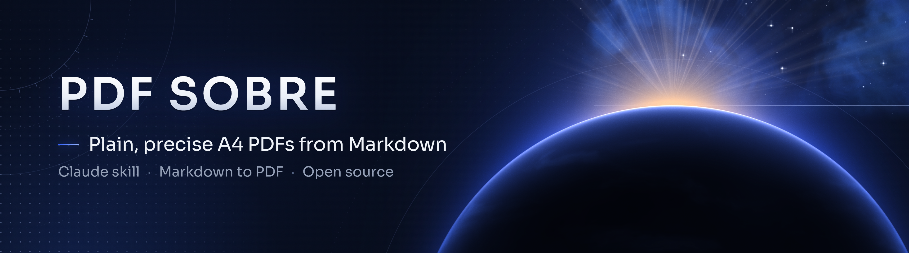
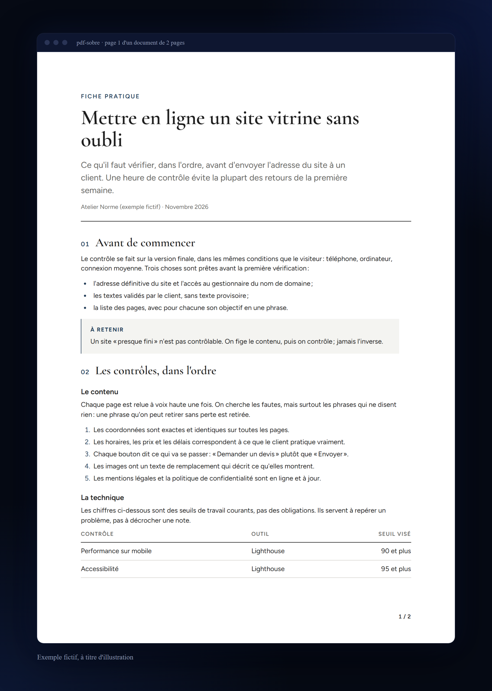
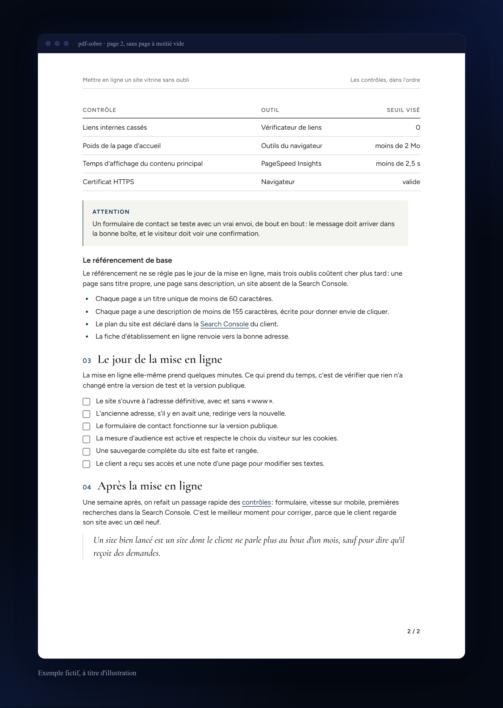

<p align="center">
  
</p>

<p align="center">
  
  
  
</p>

# pdf-sobre — PDF Sobre

**Un PDF A4 sobre, classique et précis à partir d'un simple texte Markdown, avec une mise en pages qui ne laisse jamais de page vide ou à moitié vide.**
*Plain, precise A4 PDFs from Markdown. No half-empty pages.*

## ✦ Ce que fait le skill

| | |
|---|---|
| **Mise en pages automatique** | Pas de page vide, pas de titre seul en bas de page, resserrage automatique de la dernière page. |
| **Lisible partout** | Signets, liens cliquables, sommaire cliquable, métadonnées, PDF balisé pour l'accessibilité. |
| **Un style, une charte** | Papier blanc, encre presque noire, un accent bleu encre, Cormorant Garamond et Figtree ; charte client en tête du `:root`. |
| **Contrôles bloquants** | Nombre de pages tenu, remplissage minimal, rendu PNG par page. |

## ✦ Installation

**Télécharger** : bouton vert **Code → Download ZIP**, ou :

```bash
git clone https://github.com/horizonchapter/pdf-sobre.git
```

**Claude Code** (pour tous tes projets) :

```bash
cp -r pdf-sobre/skills/pdf-sobre ~/.claude/skills/
```

**Claude (app et web)** : importe le fichier [`pdf-sobre.zip`](pdf-sobre.zip) dans les réglages des skills de Claude.

## ✦ Utilisation

- « Fais-moi un PDF de ce texte, 2 pages maximum. »
- `node skills/pdf-sobre/scripts/build.mjs` puis `render.mjs` (voir SKILL.md)

## ✦ Aperçu

<p align="center">
  
  
</p>

<p align="center"><sub><i>Exemple fictif, à titre d'illustration.</i></sub></p>

## ✦ Prérequis

Node.js ; un Chromium installé par Playwright pour le rendu. Le PDF d'exemple complet : [`exemple.pdf`](skills/pdf-sobre/exemples/exemple.pdf).

## ✦ Remplace

[pdf-luxe](https://github.com/horizonchapter/pdf-luxe) (style ivoire et or) reste publié : même idée, autre style.

## ✦ Structure

```
pdf-sobre/
├── skills/pdf-sobre/
│   ├── SKILL.md
│   ├── assets/sobre.css     la charte
│   ├── scripts/             build.mjs (Markdown -> HTML A4), render.mjs (HTML -> PDF + PNG)
│   └── exemples/            exemple.md, exemple.pdf, pages PNG
├── pdf-sobre.zip
└── assets/             bannière
```

## ✦ Voir aussi

[design-horizon](https://github.com/horizonchapter/design-horizon) · [publication-sure](https://github.com/horizonchapter/publication-sure) · [memoire-relais](https://github.com/horizonchapter/memoire-relais) · [decision-business](https://github.com/horizonchapter/decision-business) · [skill-booster](https://github.com/horizonchapter/skill-booster) · [clearmind](https://github.com/horizonchapter/clearmind)

## ✦ Licence

[MIT](LICENSE). Historique des versions : [CHANGELOG](CHANGELOG.md).
